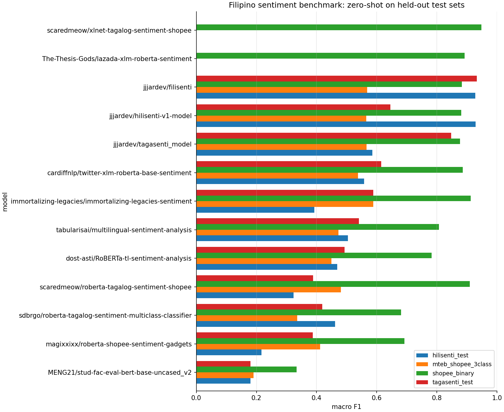

# jjjardev Filipino Sentiment Models

Zero-shot benchmark results for three Filipino sentiment classifiers: `jjjardev/tagasenti_model`, `jjjardev/filisenti`, and `jjjardev/hilisenti-v1-model`. The benchmark compares them with 10 public models on four test sets.

## Overview

`jjjardev/tagasenti_model` scores 0.8475 macro F1 on the TagaSenti test split. `jjjardev/filisenti` scores 0.9327 on the same split and 0.9272 on Hiligaynon. Across the four test sets, FiliSenti has the highest mean macro F1 among 3-class models at 0.8276. HiliSenti follows at 0.7549, TagaSenti sits at 0.7190, and the strongest 3-class model outside the jjjardev family, cardiffnlp, reaches 0.6492. The top three mean scores belong to jjjardev models.

The benchmark is zero-shot. No model is fine-tuned on the test sets. The same text and label space run through the same scoring code for every model. Full results are in `benchmark_results.csv`.

## Results

Macro F1 by test set. The Mean column averages the four scores. Binary-only models are excluded from the mean and from the table because a model that never outputs neutral cannot be scored fairly on a three-class test.

| Model | TagaSenti | Hiligaynon | Shopee binary | MTEB Shopee | Mean |
|---|---:|---:|---:|---:|---:|
| jjjardev/filisenti | 0.9327 | 0.9272 | 0.8825 | 0.5680 | 0.8276 |
| jjjardev/hilisenti-v1-model | 0.6454 | 0.9287 | 0.8808 | 0.5648 | 0.7549 |
| jjjardev/tagasenti_model | 0.8475 | 0.5850 | 0.8768 | 0.5665 | 0.7190 |
| cardiffnlp/twitter-xlm-roberta-base-sentiment | 0.6152 | 0.5583 | 0.8860 | 0.5374 | 0.6492 |
| immortalizing-legacies/immortalizing-legacies-sentiment | 0.5880 | 0.3925 | 0.9120 | 0.5881 | 0.6202 |
| tabularisai/multilingual-sentiment-analysis | 0.5403 | 0.5044 | 0.8070 | 0.4727 | 0.5811 |
| dost-asti/RoBERTa-tl-sentiment-analysis | 0.4926 | 0.4687 | 0.7827 | 0.4490 | 0.5483 |
| MENG21/stud-fac-eval-bert-base-uncased_v2 | 0.1806 | 0.1797 | 0.3333 | 0.1905 | 0.2210 |



## Models

| Model | Language focus | Best 3-class result | Typical use |
|---|---|---|---|
| `jjjardev/filisenti` | Tagalog and Hiligaynon | 0.9327 TagaSenti | One checkpoint for both languages |
| `jjjardev/hilisenti-v1-model` | Hiligaynon | 0.9287 Hiligaynon | Hiligaynon only |
| `jjjardev/tagasenti_model` | Tagalog and Taglish | 0.8475 TagaSenti | Tagalog specialist |

`tagasenti_model` is the Tagalog model. It scores 0.8475 on the TagaSenti test set and 0.8768 on the binary Shopee set. Its Hiligaynon score drops to 0.5850. Its MTEB score drops further, to 0.5665, with neutral recall at 0.1825. The drop on Hiligaynon is expected. The model is trained for Tagalog and Taglish, not for cross-lingual transfer into another Philippine language.

`filisenti` covers both languages and leads the table. `hilisenti-v1-model` is the Hiligaynon specialist. All three models are available on the Hugging Face Hub.

## Interpreting the results

The TagaSenti and Hiligaynon columns give the cleanest comparison, and every 3-class model runs on both. The TagaSenti test split holds 743 negative rows, 653 neutral, and 604 positive. The Hiligaynon split has fewer neutral rows. The Shopee binary column favors models trained on e-commerce reviews, so several models from other authors close the gap there. The MTEB column is the hardest. Its neutral class is a single star rating, and most models miss a large share of that class.

FiliSenti's lead tracks the combined-language training set. Training on Tagalog and Hiligaynon gives a smaller cross-lingual penalty on Hiligaynon than TagaSenti carries. HiliSenti is the reverse: strong on Hiligaynon, weak on Tagalog. TagaSenti is the Tagalog specialist, and its 0.8475 is the number to compare against the published TagaSenti result.

## Benchmark design

| Test set | Rows used | Labels | Source |
|---|---:|---|---|
| `tagasenti_test` | 2,000 | negative, neutral, positive | TagaSenti CSV, stratified 80/10/10 split, seed 42 |
| `hilisenti_test` | 2,000 | negative, neutral, positive | HiliSenti test split |
| `shopee_binary` | 1,000 | negative, positive | scaredmeow binary test split |
| `mteb_shopee_3class` | 2,000 | negative, neutral, positive | MTEB test split, five stars mapped to three classes |

The TagaSenti split is rebuilt from a single CSV, and the other three sets come from released test splits. Each set is capped to keep the full run inside a free Colab session.

Models with explicit `id2label` mappings use those labels. Four models have no usable label names, so the notebook probes each model with two sentences per sentiment and prints the inferred order. Two-label models run only on the binary set. Three-class models on the binary set have their negative and positive probabilities renormalized. The CSV records accuracy, macro F1, per-class recall, and the row count.

## Reproduce

Open `tagasenti_full_benchmark_colab.ipynb` in Colab or Jupyter. Run the first cell to install the dependencies, then run the rest of the notebook. Set `SAMPLE_CAP` to 500 for a quick smoke test, then check `benchmark_results.csv` and `benchmark_chart.png`.

## Usage

```python
from transformers import pipeline

classifier = pipeline(
    "text-classification",
    model="jjjardev/tagasenti_model",
    tokenizer="jjjardev/tagasenti_model",
    truncation=True,
    max_length=128,
)

print(classifier("Sobrang ganda ng quality ng tela, sulit na sulit ang bayad"))
```

Replace the model ID with `jjjardev/filisenti` or `jjjardev/hilisenti-v1-model` to use the other checkpoints. The models take raw text. HiliSenti performs best on lowercased, normalized Hiligaynon input.

## Limitations

The TagaSenti test split may not match the published split. It is reconstructed from a single CSV. Each set is capped, which keeps the run fast but widens the confidence interval. Four models have no documented label order, so their scores depend on the probe sentences. `raphgonda/FilipinoShopping` is absent because the repository ships TensorFlow weights only and the notebook loads PyTorch. MENG21 uses an English BERT base on a Filipino task. Its all-negative collapse makes that row a floor rather than a fair comparison.

None of these caveats changes the top three. Read the notebook before citing the table in a paper.

## Licenses

The code, notebook, and files in this repository use the MIT license. See `LICENSE`. The model weights and datasets keep their own terms, so check the model cards and dataset cards before commercial use.

## Links

Models: [tagasenti_model](https://huggingface.co/jjjardev/tagasenti_model), [filisenti](https://huggingface.co/jjjardev/filisenti), [hilisenti-v1-model](https://huggingface.co/jjjardev/hilisenti-v1-model)

Datasets: [TagaSenti](https://huggingface.co/datasets/jjjardev/tagasenti), [HiliSenti](https://huggingface.co/datasets/jjjardev/hilisenti-v1)

Benchmark outputs: [benchmark_results.csv](benchmark_results.csv), [benchmark_chart.png](benchmark_chart.png)

Notebook: [tagasenti_full_benchmark_colab.ipynb](tagasenti_full_benchmark_colab.ipynb)
